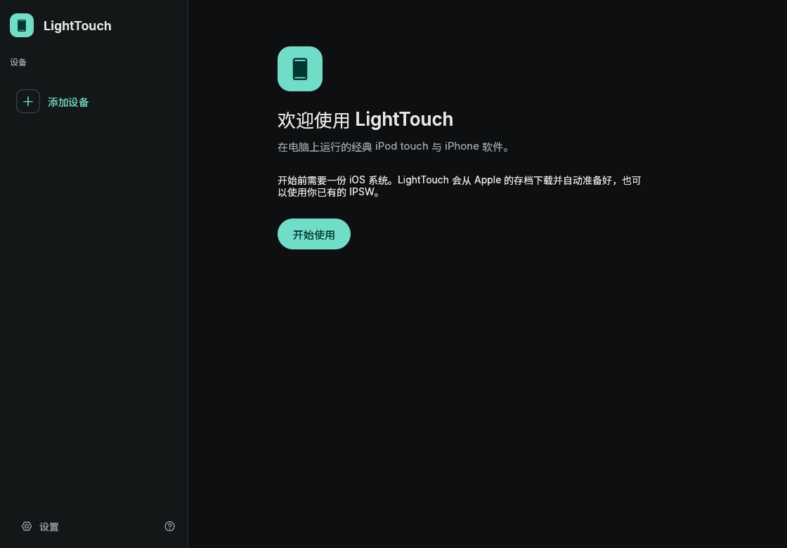
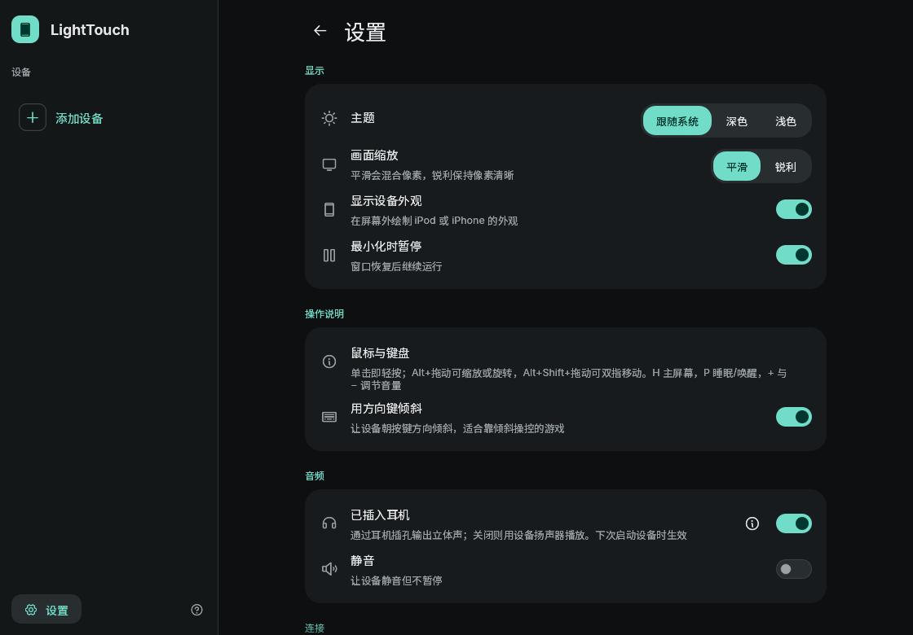
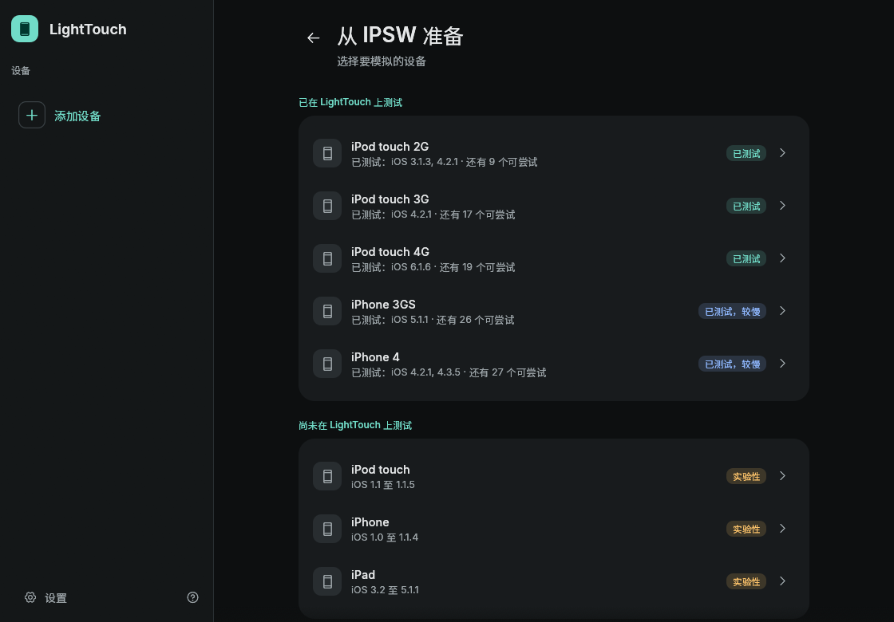
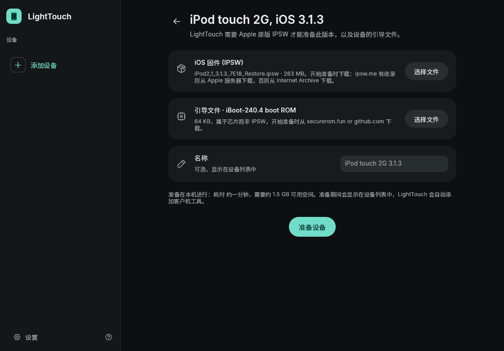
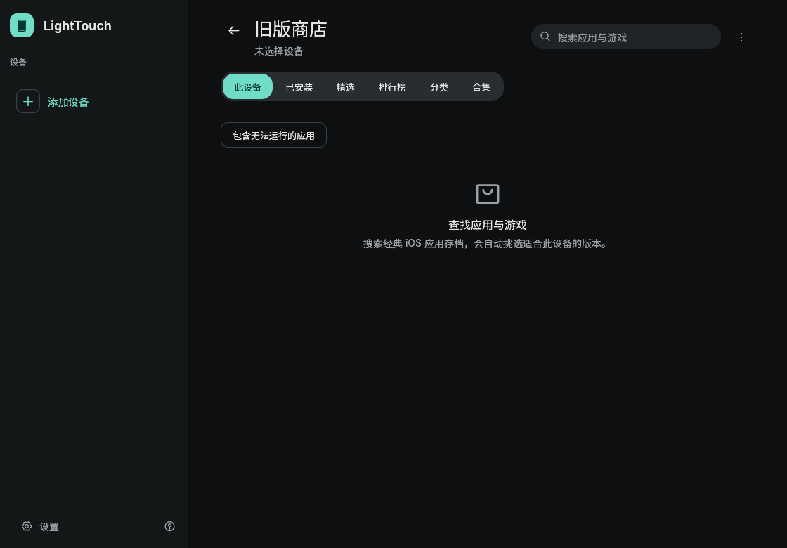

# LightTouch / Un1box — Simplified Chinese Edition

[简体中文](README.md) · [English](README.en.md)

A **third-party Simplified Chinese localization** of [blake-lucas/LightTouch](https://github.com/blake-lucas/LightTouch), plus one network fix for the Windows desktop build. LightTouch runs classic iPhone OS / iOS (1–7) software through qemu-ios.

- Android: localized from **v0.0.11 debug build** (commit `3e0484d`)
- Windows: localized from **v0.0.12 release**, with a fix for the "can't reach Legacy Store" timeout behind proxies

This repository ships the localization and the builds only. It does **not** include Apple firmware (IPSW); the app downloads and prepares that on first run.

## Downloads

Android and Windows are published as two separate releases:

| File | Notes | Download |
| --- | --- | --- |
| `LightTouch-0.0.11-android-arm64-zh.apk` | Android 10+, ARM64, Chinese UI | [android-v0.0.11-zh](https://github.com/18-boop/LightTouch-zh/releases/tag/android-v0.0.11-zh) |
| `LightTouch-0.0.12-windows-x86_64-zh.zip` | Windows 10/11 x64, Chinese UI + proxy fix, portable | [windows-v0.0.12-zh](https://github.com/18-boop/LightTouch-zh/releases/tag/windows-v0.0.12-zh) |
| `source/lighttouch-android-0.0.11-zh-patch.tar.gz` | Android changes: 179 modified smali files, translation table, patch/verify scripts | In repo |
| `source/lighttouch-v0.0.12-desktop-zh-source.tar.gz` | Full buildable Rust workspace for the Windows build (font + proxy fix included) | In repo |
| `SHA256SUMS.txt` | SHA-256 of every artifact | In repo |

## Screenshots

Windows desktop build (the Android app uses the same layout):

| | |
|---|---|
|  |  |
|  |  |
|  | |

## Android

1. **Uninstall any existing LightTouch/Un1box first.** This build is signed with a third-party self-signed key, so it cannot install over the original.
2. Uninstalling removes app data: prepared devices, iOS images and installed apps live in private storage (`allowBackup=false`).
3. After installing, follow the setup wizard. The iPod touch 2G on iOS 3.1.3 is the quickest (~1 minute).

## Windows

1. Unzip the whole archive, then run `lighttouch.exe` (don't copy the exe alone — `resources/` holds the engine and DLLs).
2. Behind a proxy (Clash, V2Ray and friends): **no need to turn the system proxy on.** The app tries `HTTPS_PROXY` → the Windows system proxy → a proxy listening on a common local port (7897 / 7890 / 7891 / 10809 / 10808).
3. If your proxy uses another port, start it with `set HTTPS_PROXY=http://127.0.0.1:PORT`.
4. The data directory is unchanged from upstream, so existing devices and settings keep working.

## What changed

**Android 0.0.11** — the UI strings are hardcoded in Kotlin (Jetpack Compose); `res/values/strings.xml` holds only androidx/Material3 strings. The localization was therefore done on `const-string` literals in the decompiled smali: **602 strings, 706 replacements, 179 smali files**. Native libraries, assets, the manifest, the package name and every format string / preference key / enum `.name` are untouched.

**Windows 0.0.12** — a Rust + egui binary, so it had to be rebuilt from source: egui's bundled fonts contain no CJK glyphs, and `&str` literals carry their length. **602 table entries + long paragraphs, 726 replacements across 4 crates.** Noto Sans SC (subset, OFL) is embedded as a font fallback.

**The fix** — upstream's `ureq` client had no proxy configured at all, so in a proxied environment the Legacy Store always failed with `timeout: connect`. The client now resolves a proxy in three steps (environment → Windows system proxy → local port probe), respects `NO_PROXY`/`ProxyOverride`, and the store error message says what to check.

Kept in English on purpose: logs, CLI output, protocol fields, Apple terms (IPSW/IPA/boot ROM), hardware specs.

## Known limits

- Android build has not been through a full real-device run (static checks only: dex parse, identical manifest, byte-identical native libs, v3 signature).
- Windows build was verified for startup, shutdown and 8 UI screenshots; booting an actual emulated device and the online store listing (needs a ~300 MB firmware download) were not exercised.
- Only the UI text changed; no emulation logic was touched.

## Source and license

- Upstream: <https://github.com/blake-lucas/LightTouch> (GPL-2.0-or-later)
- Android corresponding source = upstream tag `v0.0.11` + the smali changes and translation table in `source/lighttouch-android-0.0.11-zh-patch.tar.gz`
- Windows corresponding source = upstream `v0.0.12` + `source/lighttouch-v0.0.12-desktop-zh-source.tar.gz` (complete workspace)
- Font: Noto Sans SC, SIL Open Font License 1.1

This project is distributed under **GPL-2.0-or-later** as well. iPhone, iPod touch and iPad are trademarks of Apple Inc.; this project is not affiliated with Apple.

## Verify

```bash
sha256sum -c SHA256SUMS.txt
```
